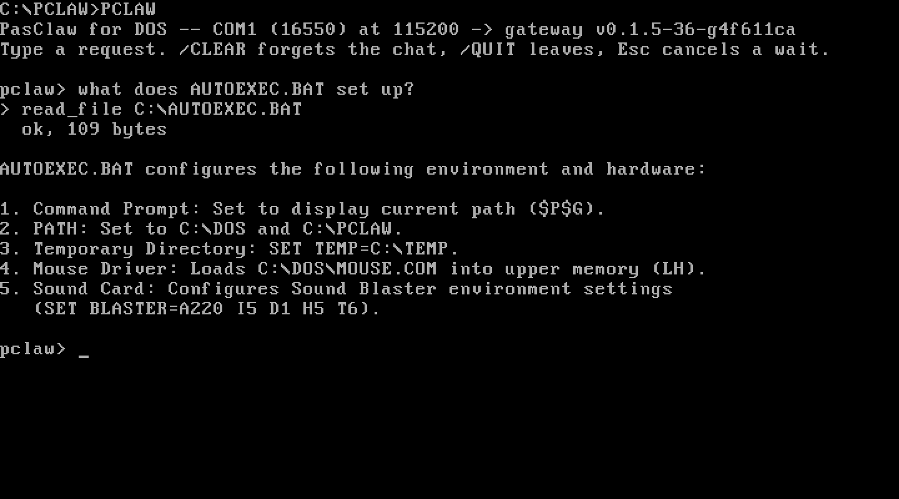

# PasClaw on DOS

`PCLAW.EXE` is a PasClaw agent for MS-DOS. The agent loop and its tools run
on the DOS PC: the model reads its files, lists its directories, writes and
edits files and runs commands through `COMMAND.COM`, asking you before each
write, edit and command. The one thing a DOS PC cannot do, reach a model
(no TCP/IP, no TLS), goes down a serial line to `pasclaw bridge` on a
modern machine, which hands each request to a PasClaw gateway.

```
 DOS PC                                   modern machine
┌──────────────────────┐  null-modem   ┌───────────────────┐  HTTP(S)  ┌──────────────────┐
│ PCLAW.EXE            │    cable      │ pasclaw bridge    │  + token  │ pasclaw gateway  │── provider
│  agent loop, tools,  │ ────────────► │  3 routes, CRC,   │ ────────► │  /v1/responses   │   keys, TLS
│  CP437 screen+files  │  HTTP/1.1 +   │  slims answers    │           │  (tools passed   │
│  COM1, 115200 8N1    │  CRC-32       │                   │           │   through)       │
└──────────────────────┘               └───────────────────┘           └──────────────────┘
```

The provider keys, the gateway token and TLS never leave the modern
machine. The gateway passes the DOS client's tools through to the model
(`/v1/responses` with `function` tools) and returns the model's tool calls
unrun; they run on DOS and their results go back in the next request.



A real session in DOSBox-X: COM1 to `pasclaw bridge`, a gateway, Gemini.

For a Windows XP machine you do not need any of this: XP has TCP/IP, and
the full `pasclaw.exe` builds for it. See [Windows XP](./windows-xp.md).

## What you need

- **The DOS PC**: a 486 or later, MS-DOS 5+ or FreeDOS, a serial port.
  `PCLAW.EXE` (about 390 KB) and `CWSDPMI.EXE` (the DPMI host it runs
  under) in one directory. In DOSBox-X it ran with 2 MB of memory; it does
  not run on a 386.
- **The cable**: a null-modem cable (send and receive crossed), or a
  straight cable with a null-modem adapter; a USB-serial adapter on the
  modern side is fine. No flow control lines are used.
- **The modern machine**: `pasclaw gateway` with a working provider, and
  `pasclaw bridge` beside it (or anywhere that can reach the gateway).

## Build

```sh
make dos-toolchain   # once: builds the i386 cross compiler, fetches the DOS units (~76 MB zip)
make dos             # build/dos/PCLAW.EXE + build/dos/CWSDPMI.EXE
```

`make dos-toolchain` runs `scripts/setup-dos-toolchain.sh`. It needs
`fpc` 3.2.2 and its source (`apt install fpc fpc-source`), `curl` and
`unzip`, and puts everything in `~/.cache/pasclaw/dos-toolchain`
(`DOS_TOOLCHAIN=` to move it). The compiler is built from source in a few
seconds; the DOS RTL and the four packages the client uses come from the
official FPC 3.2.2 DOS release, checked against a pinned SHA-256.

Copy the two files from `build/dos/` to the DOS PC however you can: a
floppy, a CF card, or a serial file transfer.

## Run

On the modern machine:

```sh
pasclaw gateway                          # if it is not running already
pasclaw bridge --serial /dev/ttyUSB0     # Linux; COM3 on Windows
```

On the DOS PC:

```
C:\PCLAW> PCLAW
PasClaw for DOS -- COM1 (16550) at 115200 -> gateway v0.1.6
Type a request. /CLEAR forgets the chat, /QUIT leaves, Esc cancels a wait.

pclaw> what is in AUTOEXEC.BAT?
> read_file C:\AUTOEXEC.BAT
  ok, 212 bytes

It sets the PATH to C:\DOS;C:\UTIL, loads MOUSE.COM and starts ...
```

One request, then exit: `PCLAW /P:"list the .BAS files here"`, or a
request kept in a file, `PCLAW /F:TASK.TXT`. Words after the switches are
the request too: `PCLAW what version of DOS is this`.

| Switch | Default | |
|---|---|---|
| `/PORT:COM1` | `COM1` | `COM1`..`COM4`. The address comes from the BIOS table. |
| `/BAUD:115200` | `115200` | 300 .. 115200. The bridge must use the same (`--baud`). |
| `/MODEL:name` | the gateway's | A model the gateway knows. |
| `/YES` | off | Write, edit and run without asking. |
| `/STEPS:20` | 20 | Model calls per request. |
| `/TIMEOUT:300` | 300 | Seconds to wait for one model call. |
| `/HISTORY:24000` | 24000 | Bytes of conversation kept; the oldest whole turns go first. |
| `/P:text`, `/F:file` | | One request, then exit. |
| `/V` | off | Show each request's size and time. |

The same settings can go in `PCLAW.CFG` (in the current directory or beside
`PCLAW.EXE`) as `KEY=VALUE` lines: `PORT=COM2`, `BAUD=38400`, `MODEL=...`.
Switches win. Exit codes: 0 done, 1 the request failed, 2 no bridge or
gateway, 3 a bad switch.

### In DOSBox-X

DOSBox-X can wire its COM1 to a TCP port. Run the bridge on TCP instead:

```sh
pasclaw bridge                           # listens on 127.0.0.1:5150
```

and in the DOSBox-X config (or with `-set`):

```ini
[serial]
serial1=nullmodem server:127.0.0.1 port:5150 transparent:1
```

`transparent:1` matters: without it DOSBox-X mixes modem-line signalling
into the byte stream. A serial-to-Ethernet adapter on a real DOS PC works
the same way: `pasclaw bridge --listen 0.0.0.0:5150`.

## The bridge

```sh
pasclaw bridge [--listen [ADDR:]PORT | --serial DEVICE [--baud N]]
               [--gateway URL] [--token TOKEN] [--model NAME] [--timeout SEC]
```

- **What crosses.** `POST /v1/responses`, `GET /v1/health` and
  `GET /v1/models`, nothing else: whoever holds the serial line gets the
  model, not the gateway's files, shell, config or sessions. Other routes
  are answered 403 without reaching the gateway.
- **Only the client's own tools.** A `/v1/responses` request must bring
  at least one function tool. With one, the gateway hands the tools to
  the model and returns its tool calls unrun, to run on the DOS PC.
  Without one, the gateway would run its own agent loop with its own
  tools on its own machine, so the bridge answers such a request 400 and
  never forwards it.
- **Which gateway.** By default the one this `PASCLAW_HOME` runs
  (`run/gateway.json`, else `127.0.0.1:<gateway.port>`), with this
  config's gateway token. `--gateway URL` (or `$PASCLAW_GATEWAY_URL`) names
  another; it gets `--token` or `$PASCLAW_GATEWAY_TOKEN`, never this
  config's token.
- **Rewrites.** `"stream"` is forced off (the line carries one framed
  answer); `--model` fills in a model for a request naming none; and the
  answer is cut to `id`, `status`, `error`, `output` and `usage`. The full
  Responses object echoes the request's tools and a dozen settings, 2-3 KB
  a step that a 9600-baud line takes seconds to carry.
- **Listening.** `--listen` binds `127.0.0.1` unless told otherwise, and
  says so when it is not loopback: anyone who can reach the port can use
  the model through your gateway token.

## On the wire

Plain HTTP/1.1, one request then its answer, framed by `Content-Length`
(never chunked). Two headers make a serial line safe for it:

- `X-PasClaw-CRC32`: the IEEE CRC-32 of the body, in hex, on every request
  and answer. A body that does not match is refused: the bridge answers
  400 `crc` and the client sends the request again; the client sends a
  request again when its answer is damaged or cut off (three tries).
- `X-PasClaw-Seq`: the client numbers its requests and the bridge echoes
  the number, so an answer to an earlier try that arrives late is skipped.
  Numbering starts at random, so an answer a cancelled run left on the
  line cannot pass for the next run's.

The bridge skips anything before a line that starts with a method, so it
finds the next request after line noise. A request without the CRC header
is accepted, so `curl` or `socat` can talk to `--listen` for a test.

A step is about 2.5 KB up (the system prompt, the five tools and the
conversation so far, whitespace stripped) and a few hundred bytes down
plus whatever the model wrote: about a quarter of a second of line time at
115200 baud, three seconds at 9600.

## Text on DOS

Inside, the client works in UTF-8, as the model does. The DOS screen,
keyboard, text files and file names are code page 437, and the client
converts at each of those edges: `é` in a DOS file reaches the model as
`é` and comes back to the screen as `é`. A character CP437 cannot show
becomes its nearest ASCII (`--` for an em dash, straight quotes for curly
ones, `*` for a bullet) or `?`. Text files are written with CR LF and read
with CR LF turned into LF.

## Tools and their limits

| Tool | Does | Asks first |
|---|---|---|
| `read_file` | 200 lines at a time (`start_line` reads on), at most 6,000 bytes; a longer single line is cut, and the next window starts after it; a binary file is refused | no |
| `list_dir` | names and sizes, `<DIR>` for directories, the volume label left out | no |
| `write_file` | creates or replaces a file, making its directory | yes |
| `edit_file` | replaces `old_text`, which must occur exactly once | yes |
| `run` | `COMMAND.COM /C`, standard output captured (first 4,000 bytes) through a new `PCnnnnnn.TMP` file in `%TEMP%` (else the current directory), deleted afterwards | yes |

At a question, `y` allows that one, `a` allows everything for the rest of
the run, anything else refuses, and the model is told it was refused.
`COMMAND.COM` cannot redirect standard error, so only standard output comes
back, and a DOS command line holds 126 characters: the model is told to
write a longer one into a `.BAT` file and run that. Esc cancels a wait for
the model.

## Testing it

```sh
make test-dos          # the wire format and the bridge (gateway stubbed), the
                       # client's text, tools and history; then a real gateway,
                       # the bridge and the client built for this machine,
                       # over TCP and over a pair of pseudo-terminals
make test-dos-dosbox   # PCLAW.EXE itself in DOSBox-X, COM1 wired to the bridge
```

`make dos-host` builds the client for the machine you are on (Linux); its
`/PORT:` is the bridge's `host:port` or a `/dev/` serial device.
`make test-dos-dosbox` skips without `dosbox-x` or the DOS toolchain.

## Troubleshooting

- **`no answer within N s`**: the bridge is not running, is on another
  port, or the two ends are at different speeds. Check `/BAUD` against
  `--baud`, and the cable is a null-modem one.
- **`no serial port at COM1`**: the port reads back as absent; try
  `/PORT:COM2`, or check it is enabled in the BIOS.
- **`(the request was damaged on the line; sending again)`** now and
  then is the CRC doing its job. Often: lower the speed.
- **`the model call failed (401)`**: the bridge has the wrong token for
  that gateway (`--token`).
- **`the gateway at ... did not answer`** (502): start `pasclaw gateway`.
