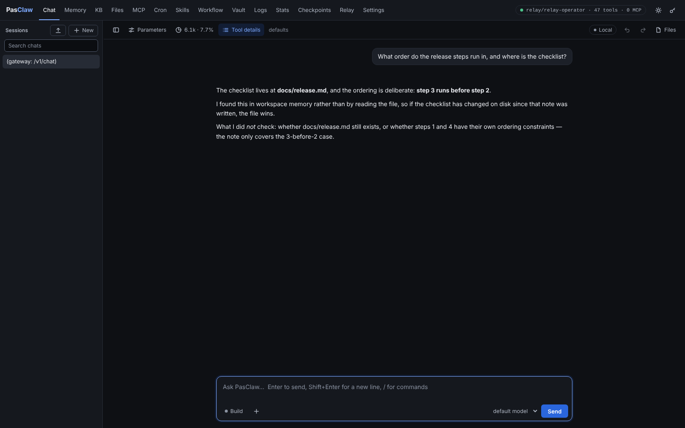
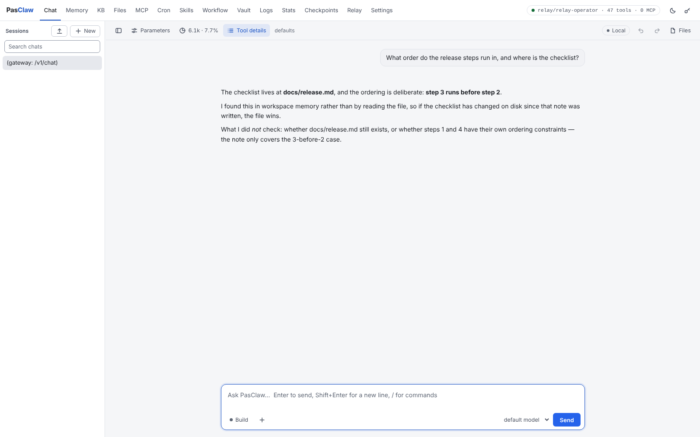
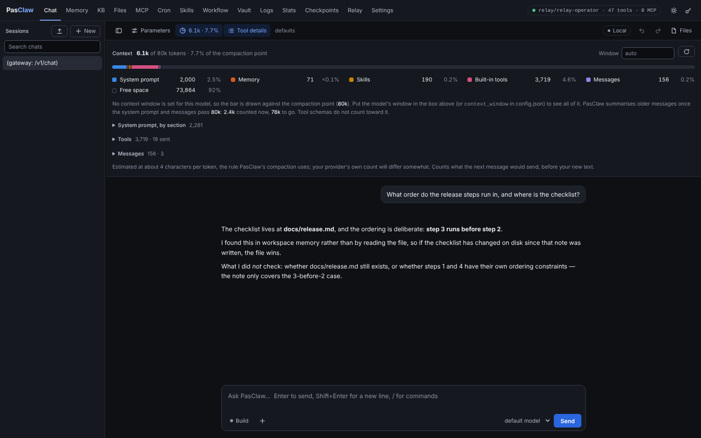
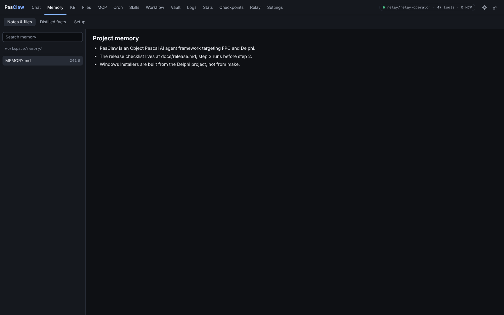
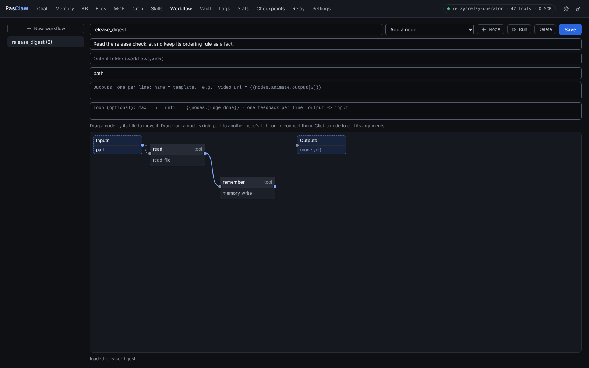
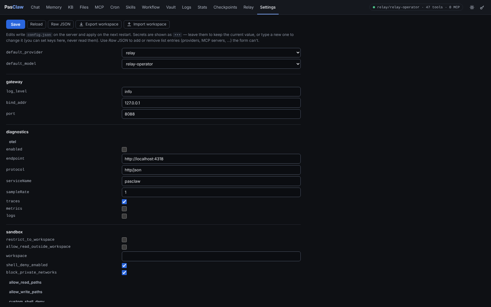
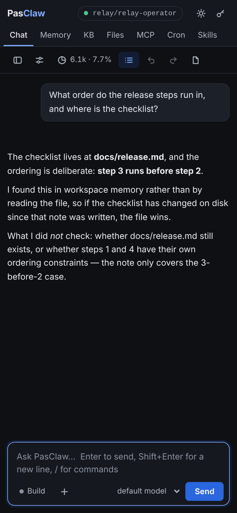
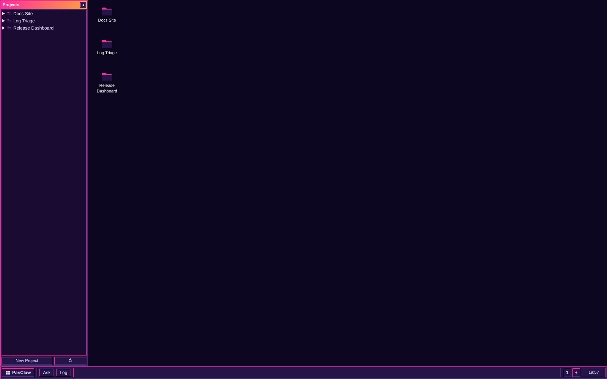

# Screenshots

PasClaw's two browser surfaces, both served by `pasclaw serve` / `pasclaw
gateway` on the same port.

## Web UI — chat (`/`)



The full operator console: the session list, the tab strip across every
subsystem (memory, KB, files, MCP, cron, skills, workflow, vault, logs,
stats, checkpoints, relay, settings), the chat toolbar, and a composer with
mode and model pickers. The status chip in the header reads
`<provider>/<model> · N tools · N MCP`.

## Web UI — light theme



The same page with the light tokens. The web UI follows the OS theme until
the theme button picks one.

## Web UI — context breakdown (chat → context button)



What the next turn puts in front of the model, part by part: system prompt,
memory, skills, tools, messages and free space, against the model's window or,
with no window set as here, the compaction point. Served by `POST /v1/context`.

## Web UI — memory (`/` → Memory)



`workspace/memory/*.md` with BM25 + vector search over it, alongside the
distilled fact store on its own tab.

## Web UI — workflow editor (`/` → Workflow)



A saved workflow: an input feeding `read_file`, whose result feeds
`memory_write`.

## Web UI — settings (`/` → Settings)



`config.json` as a form, grouped by section. Secrets show as `•••`.

## Web UI — phone width



390 px wide: the tab strip scrolls sideways, the chat list opens over the
transcript and starts closed, and the toolbar keeps its icons.

## Web desktop (`/desktop`)



The project-oriented surface: a Projects panel, desktop icons per project,
and a taskbar with Ask and Log. This is the browser desktop — distinct from
the native FMX desktop application, which is not shown here.

## Regenerating

`capture.py` seeds a gateway and drives headless Chromium against it. Two
steps, because the gateway has to be running in between:

```sh
# 1. write the fixture PASCLAW_HOME (config + MEMORY.md)
python3 docs/screenshots/capture.py init /tmp/pasclaw-shots

# 2. start a gateway against it
PASCLAW_HOME=/tmp/pasclaw-shots build/pasclaw serve --addr 127.0.0.1 --port 8330 &

# 3. seed projects, a workflow and one conversation, then capture
python3 docs/screenshots/capture.py shoot docs/screenshots
```

Each shot names its colour scheme (dark unless it says light), because the
web UI follows the OS theme and Playwright's default scheme is light.

`shoot` exits non-zero if any page logs a JavaScript error, so an unattended
regeneration cannot quietly replace these with pictures of a broken UI.

Chromium comes from Playwright (`python3 -m playwright install chromium`).
Set `PASCLAW_SHOT_CHROME=/path/to/chrome` to use a browser Playwright did not
install — needed on hosts that ship a preinstalled revision Playwright will
not look for.

### What "reproducible" means here

Run twice from a fresh fixture home at the same path, `web-ui-chat`,
`web-ui-context`, `web-ui-memory`, `web-ui-workflow`, `web-ui-settings` and
`web-ui-phone` come out **byte-identical**. Two do not:

- `web-desktop.png`: the taskbar shows a wall clock, so those bytes differ on
  every run. Everything else about it is deterministic.
- `web-ui-chat-light.png`: a few pixels of the header's status chip differ by
  one colour level between runs. Nothing you could see changes.

`web-ui-context.png` also depends on the fixture home's path, which is in the
system prompt it measures: init at a different path and the system prompt's
count moves by a token or two.

## The content is fixture data

The shots are deliberately taken against a gateway holding real content — a
finished conversation, a seeded `workspace/memory/MEMORY.md`, a saved
workflow, and three projects. An empty instance photographs the chrome and nothing else, which is
what the first attempt at these produced: a blank chat pane and "No projects
yet."

That content is created by `capture.py`, not recorded from a real session.
The projects and the workflow are invented, and the assistant reply is a string in the script
delivered through the relay provider rather than anything a model generated —
which is also why the recipe needs no API key and no network. Nothing here
should be read as a benchmark or a product claim.
