# Screenshots

PasClaw's two browser surfaces, both served by `pasclaw serve` / `pasclaw
gateway` on the same port, then the DOS client and the Windows XP build.

## Web UI — chat (`/`)

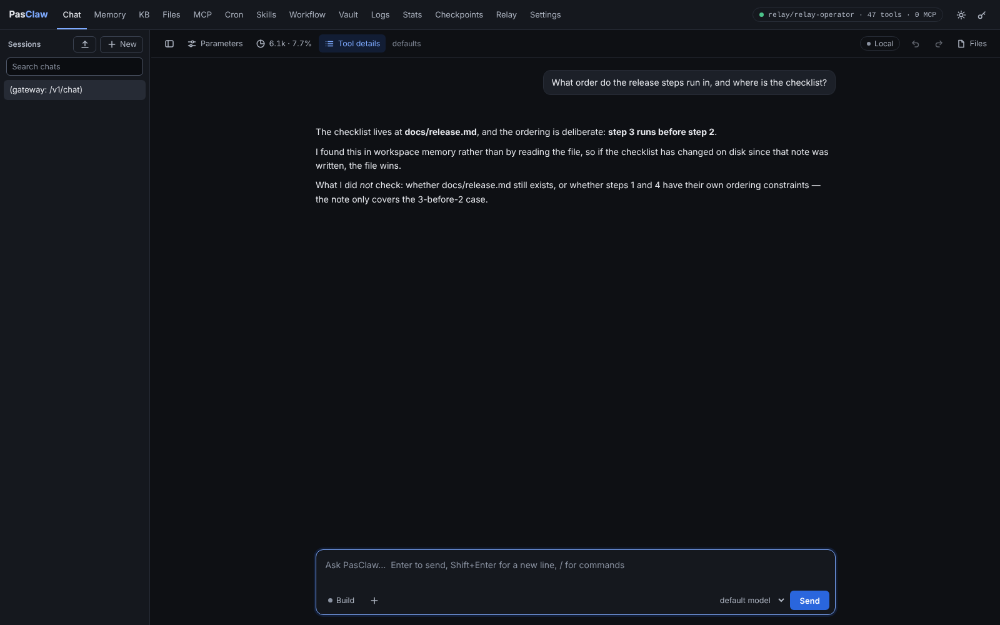

The full operator console: the session list, the tab strip across every
subsystem (memory, KB, files, MCP, cron, skills, workflow, vault, logs,
stats, checkpoints, relay, settings), the chat toolbar, and a composer with
mode and model pickers. The status chip in the header reads
`<provider>/<model> · N tools · N MCP`.

## Web UI — light theme

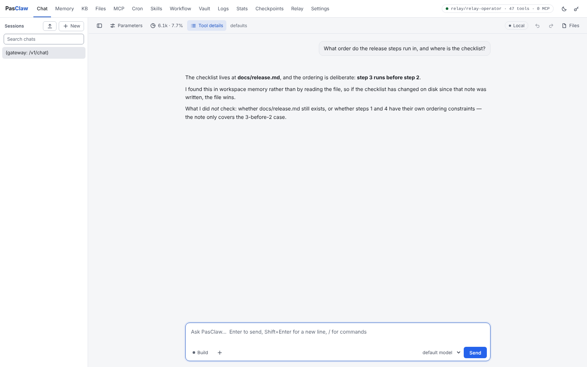

The same page with the light tokens. The web UI follows the OS theme until
the theme button picks one.

## Web UI — context breakdown (chat → context button)

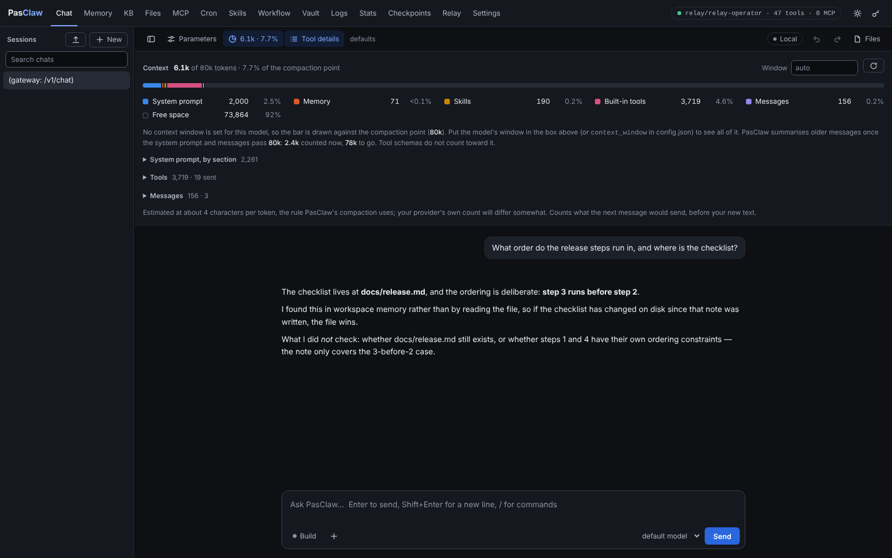

What the next turn puts in front of the model, part by part: system prompt,
memory, skills, tools, messages and free space, against the model's window or,
with no window set as here, the compaction point. Served by `POST /v1/context`.

## Web UI — background jobs (`/` → Background)

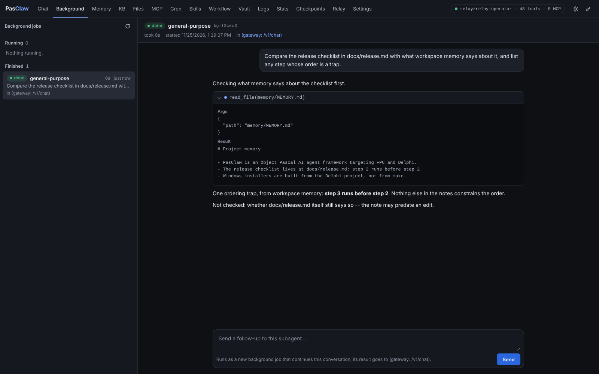

The jobs the agent started with `spawn_background` and `shell_background`,
in every chat, under Running and Finished. The open job is a subagent's
transcript, drawn like the chat with its tool call as a tool card, and a box
for a follow-up message. Served by `GET /v1/background`. The other web UI
shots above and below were taken before this tab was added to the strip.

## Web UI — memory (`/` → Memory)

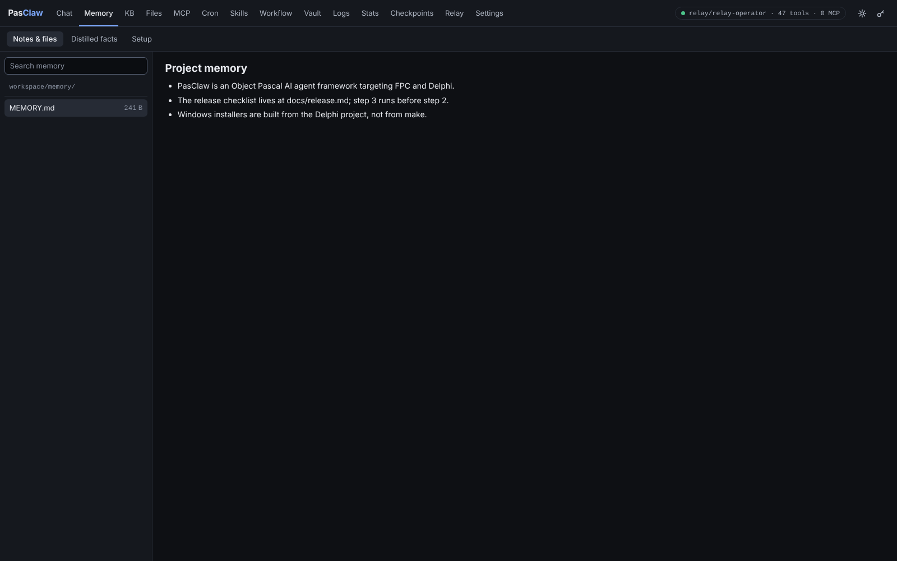

`workspace/memory/*.md` with BM25 + vector search over it, alongside the
distilled fact store on its own tab.

## Web UI — workflow editor (`/` → Workflow)

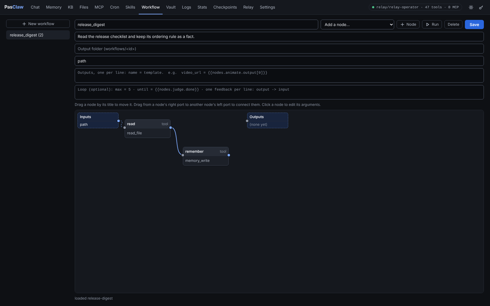

A saved workflow: an input feeding `read_file`, whose result feeds
`memory_write`.

## Web UI — settings (`/` → Settings)

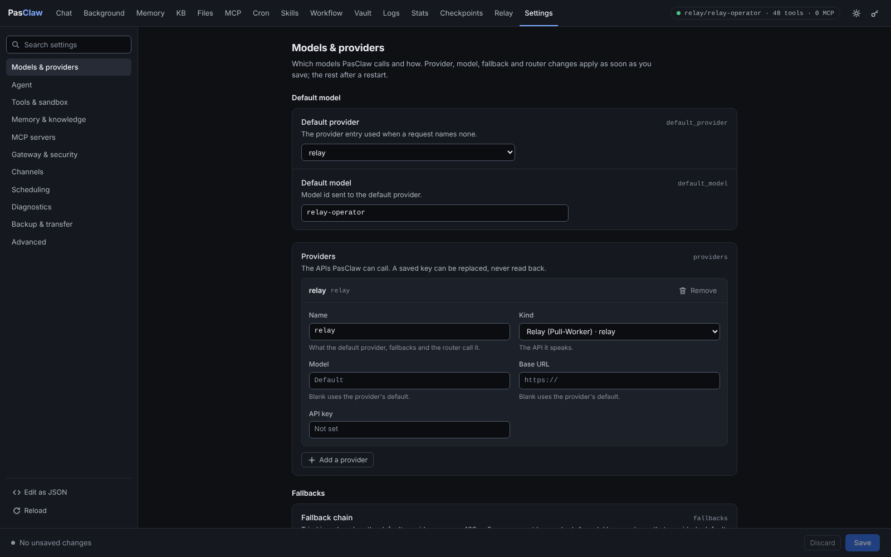

`config.json` as an editor: sections down the side with a search box, a name, a
line on what it does and the config key for each setting, providers as cards,
and a bar along the bottom that counts unsaved changes. Saved keys are
write-only fields that say whether a value is set.

## Web UI — relay (`/` → Relay)

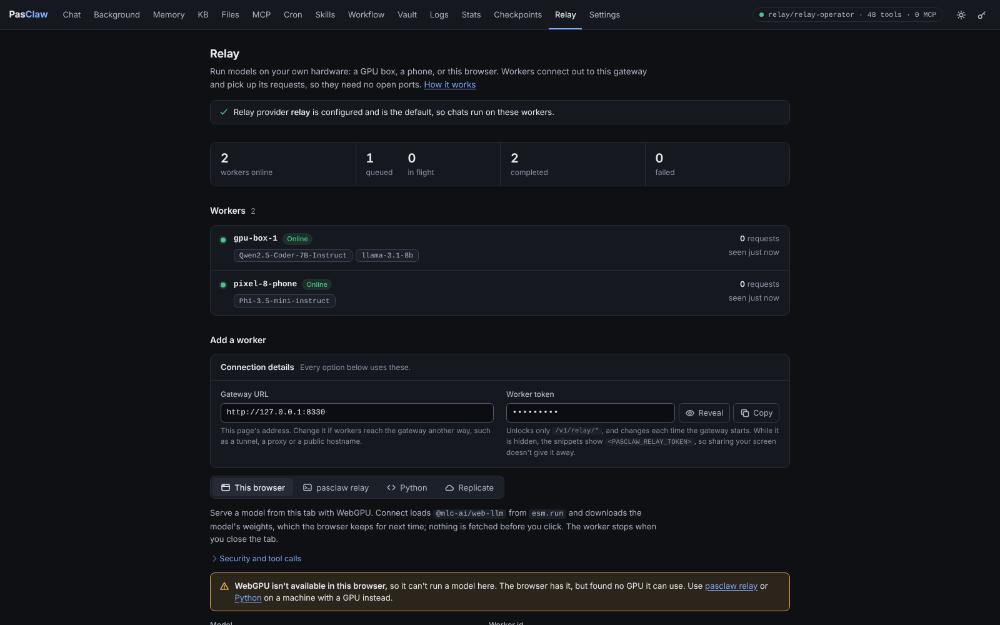

Workers that run models on their own hardware and pull the gateway's
requests ([providers-relay.md](../providers-relay.md)). The line under the
title says the default provider is a relay provider; the strip counts the
workers online and the queue; each worker is a row with its models as chips,
online, its request count and when it was last seen. Below, **Add a worker**:
the gateway URL and the masked worker token, then the options (this browser,
`pasclaw relay`, Python, Replicate). The two workers are the capture
script's own: each holds `/v1/relay/poll` open with the models it names, and
takes no job. The headless browser has no WebGPU, so the in-browser worker
says so.

## Web UI — phone width

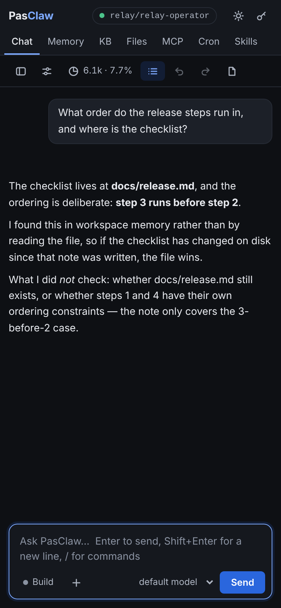

390 px wide: the tab strip scrolls sideways, the chat list opens over the
transcript and starts closed, and the toolbar keeps its icons.

## Web desktop (`/desktop`)

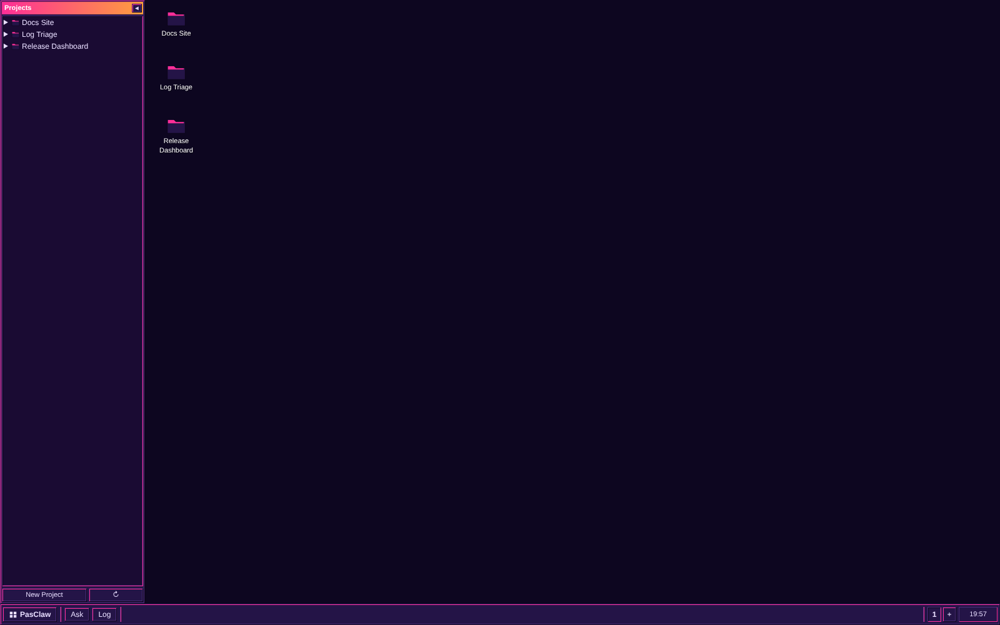

The project-oriented surface: a Projects panel, desktop icons per project,
and a taskbar with Ask and Log. This is the browser desktop — distinct from
the native FMX desktop application, which is not shown here.

## MS-DOS — `PCLAW.EXE`

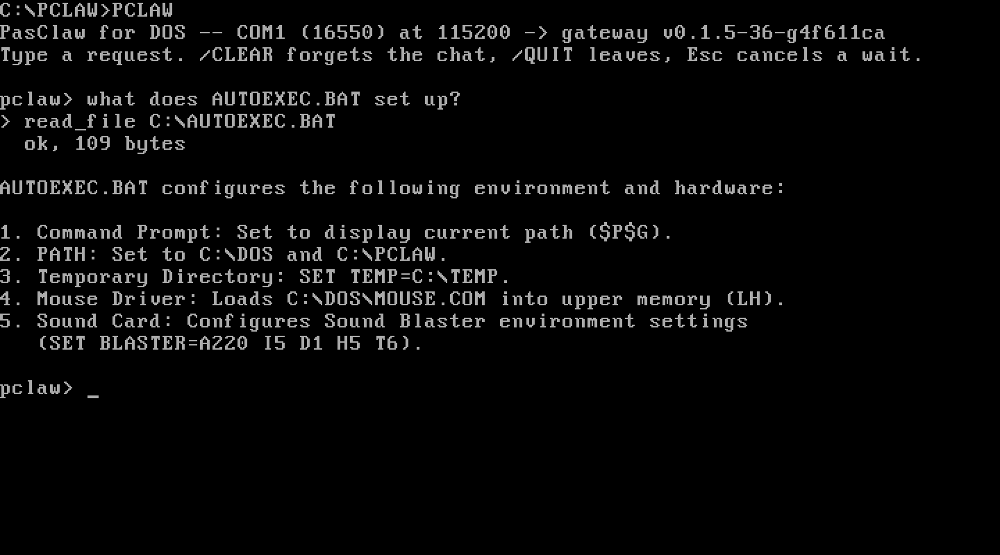

The DOS client ([dos.md](../dos.md)) in DOSBox-X, in an interactive session.
This one is a real run, not fixture data. The request was typed at the
`pclaw>` prompt. It went down COM1 (`serial1=nullmodem ... transparent:1`) to
`pasclaw bridge --listen`, then through a gateway to Gemini
(`gemini-3.5-flash`, with `gemini_server_tools.google_search` off). The
model's `read_file` ran on the DOS drive, a host folder mounted as C: that
holds a sample `AUTOEXEC.BAT` and `CONFIG.SYS`. Taken with ImageMagick
`import` from the DOSBox-X window under Xvfb (720 x 400 text mode), then
scaled 2x with nearest-neighbour. A model's answer differs from run to run,
so this one is not reproducible byte for byte.

## Windows XP — `pasclaw.exe`

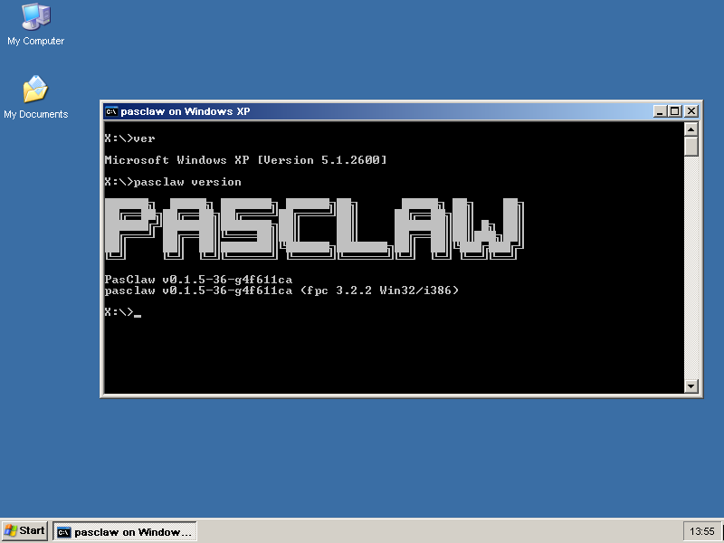

The `make xp` build ([windows-xp.md](../windows-xp.md)) on Windows XP SP2:
[VirtualXP](https://lrusso.github.io/VirtualXP/VirtualXP.htm), a LiveXP disc
in the Halfix emulator, in headless Chromium. The exe and a batch file were
added to that disc's ISO image, with a `Run` registry entry that runs the
batch file at logon (`ver`, then `pasclaw version`). The picture is the
emulator canvas's own pixels at the guest's 800 x 600. That disc has no
network stack, so there is no agent turn to show.

## Regenerating

The DOS and Windows XP shots above were taken by hand as described; this
section is about the web UI shots.

`capture.py` seeds a gateway and drives headless Chromium against it. Two
steps, because the gateway has to be running in between:

```sh
# 1. write the fixture PASCLAW_HOME (config + MEMORY.md)
python3 docs/screenshots/capture.py init /tmp/pasclaw-shots

# 2. start a gateway against it
PASCLAW_HOME=/tmp/pasclaw-shots build/pasclaw serve --addr 127.0.0.1 --port 8330 &

# 3. seed projects, a workflow and one conversation, then capture
python3 docs/screenshots/capture.py shoot docs/screenshots
```

Each shot names its colour scheme (dark unless it says light), because the
web UI follows the OS theme and Playwright's default scheme is light.

`shoot` exits non-zero if any page logs a JavaScript error, so an unattended
regeneration cannot quietly replace these with pictures of a broken UI.

Chromium comes from Playwright (`python3 -m playwright install chromium`).
Set `PASCLAW_SHOT_CHROME=/path/to/chrome` to use a browser Playwright did not
install — needed on hosts that ship a preinstalled revision Playwright will
not look for.

### What "reproducible" means here

Run twice from a fresh fixture home at the same path, `web-ui-chat`,
`web-ui-context`, `web-ui-memory`, `web-ui-workflow`, `web-ui-settings` and
`web-ui-phone` come out **byte-identical**. Four do not:

- `web-desktop.png`: the taskbar shows a wall clock, so those bytes differ on
  every run. Everything else about it is deterministic.
- `web-ui-relay.png`: the queue counts come from when the fixture's own
  requests (the memory distiller's, which no capture worker serves) reach the
  queue, so a run can show one queued or none. It is taken after the shots
  above and before the Background seeding, with its two workers gone again
  before that, so the other shots are unchanged.
- `web-ui-background.png`: the job's start time, its handle and "just now"
  come from the run. It is taken last, after `shoot` starts one background
  subagent from a chat of its own, so the shots before it are unchanged.
- `web-ui-chat-light.png`: a few pixels of the header's status chip differ by
  one colour level between runs. Nothing you could see changes.

`web-ui-context.png` also depends on the fixture home's path, which is in the
system prompt it measures: init at a different path and the system prompt's
count moves by a token or two.

## The web UI content is fixture data

The web UI shots are deliberately taken against a gateway holding real content — a
finished conversation, a seeded `workspace/memory/MEMORY.md`, a saved
workflow, and three projects. An empty instance photographs the chrome and nothing else, which is
what the first attempt at these produced: a blank chat pane and "No projects
yet."

That content is created by `capture.py`, not recorded from a real session.
The projects and the workflow are invented, and the assistant reply is a string in the script
delivered through the relay provider rather than anything a model generated —
which is also why the recipe needs no API key and no network. Nothing here
should be read as a benchmark or a product claim.
