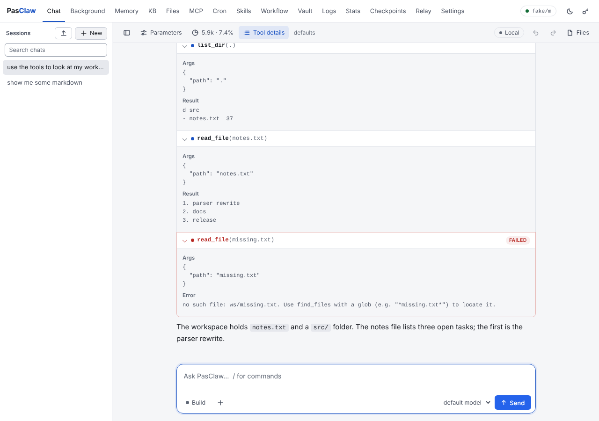
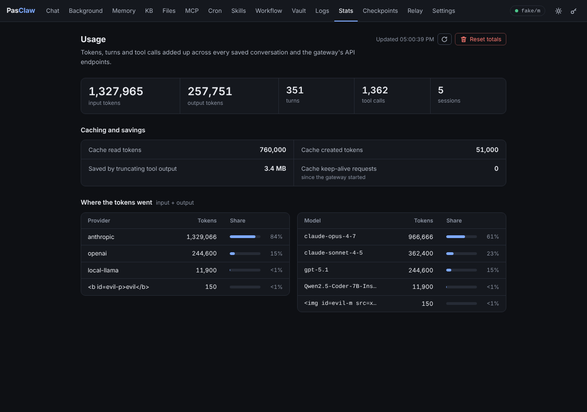
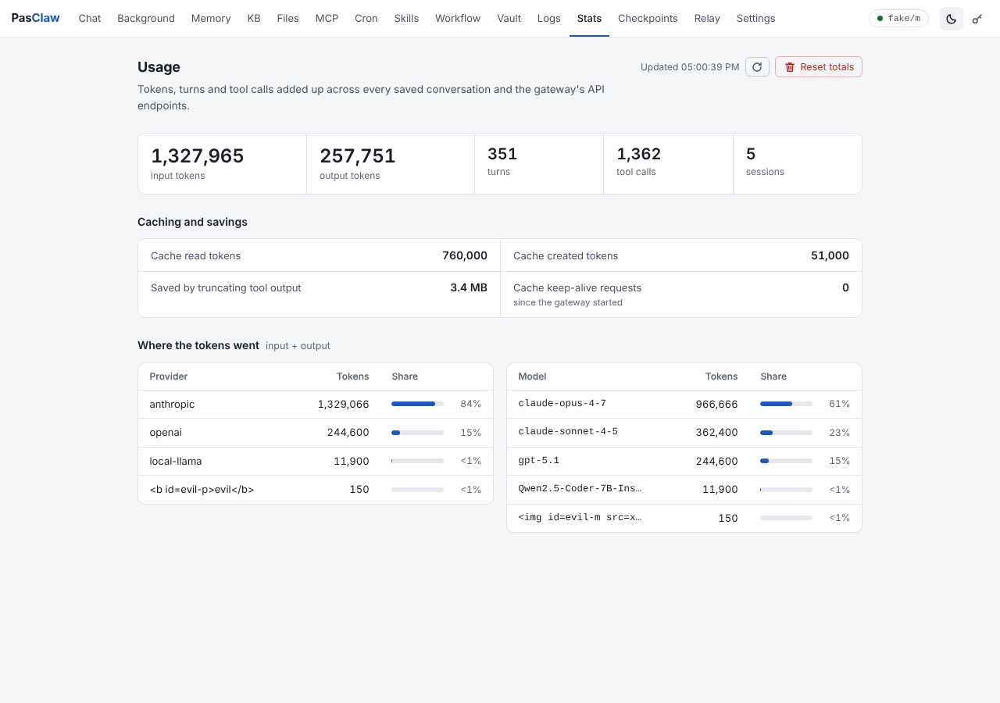
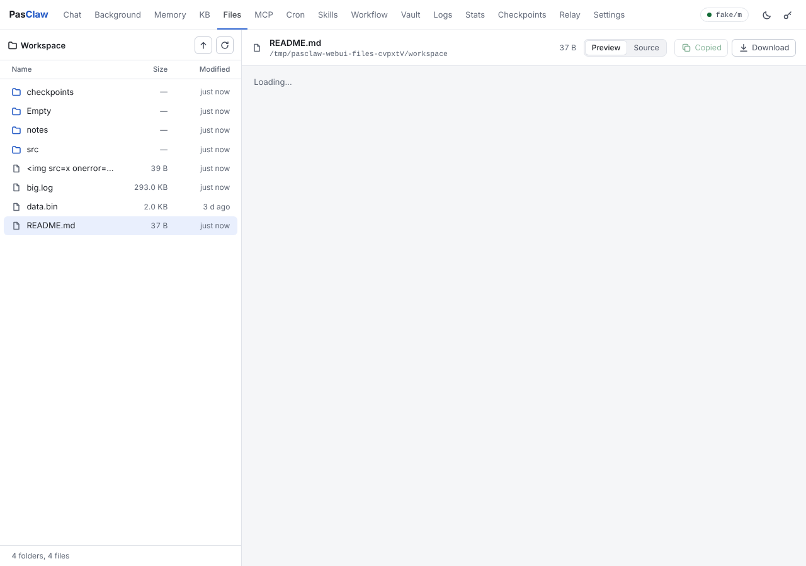
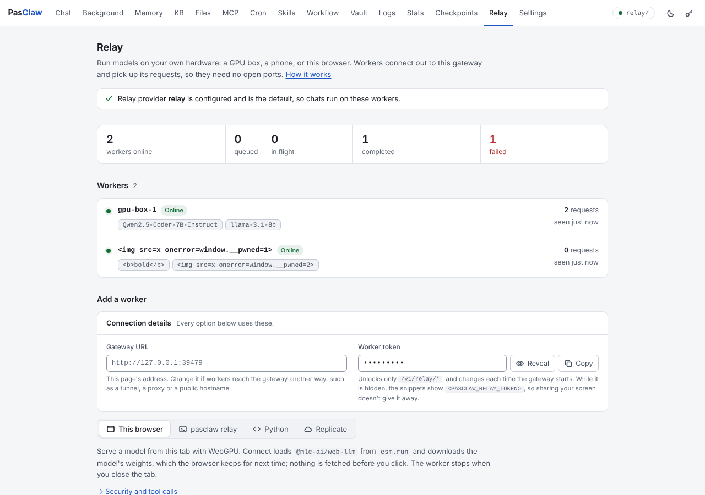

# Web UI screenshots

The redesigned tabs of the embedded web UI, captured with headless Chromium against a real gateway and fake providers and servers. All names, numbers and conversations are fixture data, not a real session. Files named `*-phone*` are 390×844; the rest are 1280×900 unless named `full-*` (the whole page).

The README's own screenshots, and the script that makes them, are in [docs/screenshots](../docs/screenshots/README.md).

## Chat

The chat page: the welcome on an empty chat, markdown with real tables and a code block with Copy, tool calls stacked with a failed badge, a long thread, and a reply streaming with **Latest** after scrolling up. Each at desktop and phone width, dark and light.

| | |
|---|---|
|  |  |

All 28: [1-empty-dark](chat/1-empty-dark.png), [1-empty-light](chat/1-empty-light.png), [1-empty-phone-dark](chat/1-empty-phone-dark.png), [1-empty-phone-light](chat/1-empty-phone-light.png), [2-markdown-dark](chat/2-markdown-dark.png), [2-markdown-light](chat/2-markdown-light.png), [2-markdown-phone-dark](chat/2-markdown-phone-dark.png), [2-markdown-phone-light](chat/2-markdown-phone-light.png), [2b-markdown-end-dark](chat/2b-markdown-end-dark.png), [2b-markdown-end-light](chat/2b-markdown-end-light.png), [2b-markdown-end-phone-dark](chat/2b-markdown-end-phone-dark.png), [2b-markdown-end-phone-light](chat/2b-markdown-end-phone-light.png), [3-tools-dark](chat/3-tools-dark.png), [3-tools-light](chat/3-tools-light.png), [3-tools-phone-dark](chat/3-tools-phone-dark.png), [3-tools-phone-light](chat/3-tools-phone-light.png), [3b-tools-toggled-dark](chat/3b-tools-toggled-dark.png), [3b-tools-toggled-light](chat/3b-tools-toggled-light.png), [3b-tools-toggled-phone-dark](chat/3b-tools-toggled-phone-dark.png), [3b-tools-toggled-phone-light](chat/3b-tools-toggled-phone-light.png), [4-long-dark](chat/4-long-dark.png), [4-long-light](chat/4-long-light.png), [4-long-phone-dark](chat/4-long-phone-dark.png), [4-long-phone-light](chat/4-long-phone-light.png), [5-streaming-dark](chat/5-streaming-dark.png), [5-streaming-light](chat/5-streaming-light.png), [5-streaming-phone-dark](chat/5-streaming-phone-dark.png), [5-streaming-phone-light](chat/5-streaming-phone-light.png).

## Stats

Usage: the token strip, caching and savings, tokens by provider and by model with each one's share, the empty state with counters off, and the in-page Reset confirm.

| | |
|---|---|
|  |  |

All 5: [stats-confirm](stats/stats-confirm.png), [stats-dark](stats/stats-dark.png), [stats-empty](stats/stats-empty.png), [stats-light](stats/stats-light.png), [stats-phone](stats/stats-phone.png).

## MCP

MCP servers: a row per server (ready, connecting, failed with its error, disabled), the counts strip, a server's tools opened, the empty state and the error state.

| | |
|---|---|
|  |  |

All 11: [mcp-empty-dark-desktop](mcp/mcp-empty-dark-desktop.png), [mcp-empty-dark-phone](mcp/mcp-empty-dark-phone.png), [mcp-empty-light-desktop](mcp/mcp-empty-light-desktop.png), [mcp-empty-light-phone](mcp/mcp-empty-light-phone.png), [mcp-error-dark-desktop](mcp/mcp-error-dark-desktop.png), [mcp-servers-dark-desktop-collapsed](mcp/mcp-servers-dark-desktop-collapsed.png), [mcp-servers-dark-desktop](mcp/mcp-servers-dark-desktop.png), [mcp-servers-dark-phone](mcp/mcp-servers-dark-phone.png), [mcp-servers-light-desktop-collapsed](mcp/mcp-servers-light-desktop-collapsed.png), [mcp-servers-light-desktop](mcp/mcp-servers-light-desktop.png), [mcp-servers-light-phone](mcp/mcp-servers-light-phone.png).

## Cron

Scheduled jobs: the schedule with a plain reading ("Weekdays at 09:00"), the skill and arguments, last run, and the empty state.

| | |
|---|---|
|  |  |

All 8: [cron-empty-desktop-dark](cron/cron-empty-desktop-dark.png), [cron-empty-desktop-light](cron/cron-empty-desktop-light.png), [cron-empty-phone-dark](cron/cron-empty-phone-dark.png), [cron-empty-phone-light](cron/cron-empty-phone-light.png), [cron-entries-desktop-dark](cron/cron-entries-desktop-dark.png), [cron-entries-desktop-light](cron/cron-entries-desktop-light.png), [cron-entries-phone-dark](cron/cron-entries-phone-dark.png), [cron-entries-phone-light](cron/cron-entries-phone-light.png).

## Files

The file browser: a folder listing, a text file with line numbers, markdown preview, a large file shown in part, a binary file, a file whose name is HTML (drawn as text), an empty folder, and the stacked phone layout.

| | |
|---|---|
|  |  |

All 21: [desktop-dark-big.log](files/desktop-dark-big.log.png), [desktop-dark-data.bin](files/desktop-dark-data.bin.png), [desktop-dark-empty-folder](files/desktop-dark-empty-folder.png), [desktop-dark-folder](files/desktop-dark-folder.png), [desktop-dark-html-named-file](files/desktop-dark-html-named-file.png), [desktop-dark-large](files/desktop-dark-large.png), [desktop-dark-text](files/desktop-dark-text.png), [desktop-light-big.log](files/desktop-light-big.log.png), [desktop-light-data.bin](files/desktop-light-data.bin.png), [desktop-light-empty-folder](files/desktop-light-empty-folder.png), [desktop-light-folder](files/desktop-light-folder.png), [desktop-light-html-named-file](files/desktop-light-html-named-file.png), [desktop-light-markdown](files/desktop-light-markdown.png), [desktop-light-text](files/desktop-light-text.png), [phone-dark-data.bin](files/phone-dark-data.bin.png), [phone-dark-folder](files/phone-dark-folder.png), [phone-dark-markdown](files/phone-dark-markdown.png), [phone-dark-text](files/phone-dark-text.png), [phone-light-data.bin](files/phone-light-data.bin.png), [phone-light-folder](files/phone-light-folder.png), [phone-light-text](files/phone-light-text.png).

## Relay

Relay: status line, queue strip, worker rows, Add a worker with the masked token and snippets, and the in-browser worker (unavailable, downloading, connected; the last two staged, since a headless browser has no GPU). `full-*` are whole-page captures.

| | |
|---|---|
|  |  |

All 14: [full-relay-add](relay/full-relay-add.png), [full-relay-dark-full](relay/full-relay-dark-full.png), [full-relay-dark](relay/full-relay-dark.png), [full-relay-light](relay/full-relay-light.png), [full-relay-phone-full](relay/full-relay-phone-full.png), [full-relay-phone](relay/full-relay-phone.png), [relay-browser-worker-connected](relay/relay-browser-worker-connected.png), [relay-browser-worker-loading-dark](relay/relay-browser-worker-loading-dark.png), [relay-browser-worker-loading-light](relay/relay-browser-worker-loading-light.png), [relay-browser-worker](relay/relay-browser-worker.png), [relay-dark](relay/relay-dark.png), [relay-light](relay/relay-light.png), [relay-phone](relay/relay-phone.png), [relay-snippets-hidden](relay/relay-snippets-hidden.png).
